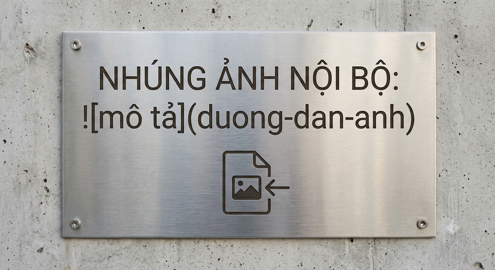

# QUY TRÌNH TIẾP NHẬN VÀ XỬ LÝ SỰ CỐ CÔNG NGHỆ

## 1. Mục đích áp dụng
### 1.1 Chi tiết các bước
Tài liệu chuẩn hóa các bước phản hồi yêu cầu kỹ thuật nội bộ của đơn vị.

## 2. Các bước triển khai
| STT | Bước Thực Hiện | Bộ Phận Xử Lý | Thời Hạn |
| :---: | :---: | :---: | :---: |
| 01 | Tiếp Nhận Thông Tin | Cán Bộ Trực | 15 Phút |
| 02 | Phân Loại Và Điều Phối | Trưởng Bộ Phận | 30 Phút |
| 03 | Phản Hồi Kết Quả | Kỹ Thuật Viên | 24 Giờ |

> **Quy định thời gian:** Phản hồi lần đầu trong vòng 30 phút kể từ khi nhận thông tin.
> **Lưu ý quan trọng:** Thời gian phản hồi tối đa là 24h kể từ khi ghi nhận.

